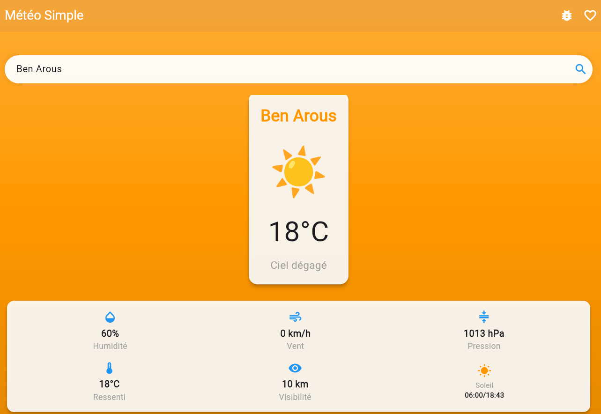
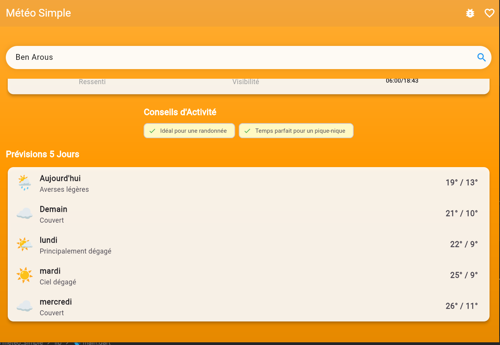

# Météo intelligente — Application Flutter

Application météo développée avec **Flutter** et **Dart**. Elle permet de rechercher une ville, de consulter les conditions météorologiques et d’afficher des prévisions sur cinq jours.

<p align="center"><strong>Flutter · Dart · API REST · OpenWeather · Open-Meteo</strong></p>

## Présentation

L’application propose une interface en français et un arrière-plan visuel qui s’adapte aux conditions météo ainsi qu’au cycle jour/nuit. Le projet prend en charge la compilation Flutter Web et peut également être exécuté sur les plateformes prises en charge par Flutter.

## Fonctionnalités

- Recherche météo par ville.
- Consultation de la température et de la description des conditions.
- Détails météo : humidité, vitesse du vent, température ressentie et heures de lever/coucher du soleil.
- Prévisions sur cinq jours avec températures minimales et maximales.
- Écran dédié aux villes favorites.
- Icônes et arrière-plans visuels adaptés aux conditions météo.
- Formatage des dates et prise en charge de la localisation française.
- Possibilité de compiler l’application pour le Web.

## 📸 Captures d’écran

### Écran météo principal

<p align="center">
  
</p>

### Deuxième aperçu de l’application

<p align="center">
  
</p>

## Technologies

| Technologie | Utilisation |
|---|---|
| Flutter / Dart | Interface multiplateforme et logique applicative |
| HTTP | Requêtes vers les services météo |
| Intl | Formatage des dates et des paramètres régionaux |
| Flutter Localizations | Localisation des composants Flutter |
| OpenWeather | Recherche de villes / géocodage |
| Open-Meteo | Données météo et prévisions |

## Prérequis

- SDK Flutter sur le canal stable
- Dart compatible avec la version de Flutter installée
- Android Studio ou Visual Studio Code
- Chrome pour tester la version Web

Vérifiez l’environnement :

```bash
flutter doctor
```

## Installation

```bash
git clone https://github.com/WissemAttouf/meteo-intelligent-flutter.git
cd meteo-intelligent-flutter
flutter pub get
```

### Configuration des services météo

L’application s’appuie sur OpenWeather pour la recherche de villes et Open-Meteo pour les données météo. Configurez une clé API OpenWeather valide dans le fichier de configuration prévu par le projet.

**Sécurité :** ne publiez pas de clés API ni d’identifiants dans le dépôt. Pour une mise en production, vérifiez les restrictions de clé et les conditions des fournisseurs.

## Exécution

Sur un appareil connecté :

```bash
flutter run
```

Dans Chrome :

```bash
flutter run -d chrome
```

## Compilation Web

```bash
flutter build web
```

Les fichiers destinés au déploiement sont générés dans `build/web/`. Après chaque modification, reconstruisez cette version avant de la publier sur un hébergeur statique.

## Vérifications

```bash
flutter analyze
flutter test
```

## Structure du projet

```text
lib/
├── config/       # Configuration des API
├── models/       # Modèles de données météo
├── screens/      # Écrans principaux et favoris
├── services/     # Requêtes vers les services météo
├── utils/        # Formatage et présentation des données
└── main.dart     # Point d’entrée
web/              # Point d’entrée et ressources Web
```

## Auteur

**Wissem Attouf** — Ingénieur logiciel | Développeur Full Stack  
[GitHub](https://github.com/WissemAttouf) · [LinkedIn](https://www.linkedin.com/in/wissem-attouf-452509226/) · [Portfolio](https://wissem-portfolio.vercel.app/) · [E-mail](mailto:wattouf35@gmail.com)
